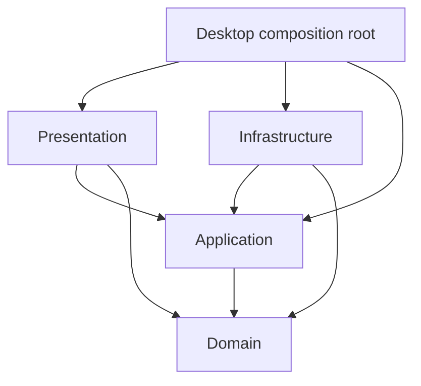
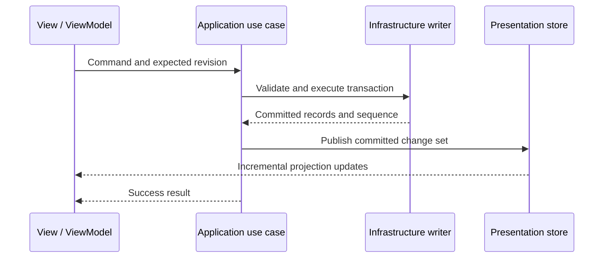

# Max Planner — Windows Application Requirements

## 1. Technical requirements

### T-01. Purpose, authority, and implementation contract

Build a new native Windows desktop application named **Max Planner** for the workflows in section 2, using **WinUI 3 and SQLite**. This is a self-contained specification for building the application from scratch; no previous application, source repository, or historical document is required to understand it. The application must work offline and be portable between compatible Windows computers.

- **MUST** is a release requirement. **SHOULD** is the preferred approach; document departures and evidence in an architecture decision record (ADR). **Deferred** is outside release 1.
- The product owner confirmed: **one Change Request (CR) has one shared Title, Task Number, Squad, and Owner and can link to zero or more tasks.** Each task can link to zero or one CR. Every linked task inherits that CR's Title, Task Number, Squad, and Owner. **A link, once created, is permanent**: it is never removed or reassigned, except when the task is deleted or the CR is deleted together with its tasks (B-05).
- Decisions marked **design default** define the baseline behavior where the product owner has not specified another choice. Implement them unless the product owner changes this specification; do not silently invent alternatives.
- This file is the authoritative implementation specification. Define all rules, formats, and acceptance criteria here or in the explicitly required schemas/ADRs created during implementation. Product-owner decisions that changed earlier drafts are recorded in `docs/adr/`.
- Track these requirement IDs in implementation issues and tests. Placeholder screens, mocked production persistence, and silently omitted requirements do not count as completion.

### T-02. Platform and dependency baseline

| Component | Requirement |
|---|---|
| Operating system | Windows 11. Tested matrix: **24H2 (build 26100) and 25H2 (build 26200)**. Compatibility floor: **build 22621 (22H2)**, documented as untested-compatible. Publish the tested edition/build matrix and distinguish compatibility with older builds from vendor support. |
| UI | Native WinUI 3 XAML using a supported **stable** Windows App SDK (2.x line at implementation start). No Electron, browser shell, WebView UI, WPF replacement, or cross-platform UI abstraction. |
| Language/runtime | **.NET 10 LTS** with its supported stable C# version. The product owner chose to build release 1 on SDK 10.0.401 (runtime 10.0.12); moving to a later servicing patch before release is an owner decision recorded in an ADR. |
| Architecture | Domain, Application, Infrastructure, Presentation, and a small Desktop composition root. |
| MVVM | `CommunityToolkit.Mvvm` in Presentation for observable state, validation, and commands, using source-generated partial properties. |
| Storage | **SQLite** through `Microsoft.Data.Sqlite` with a bundled native SQLite library. All SQL, connection, and schema types stay in Infrastructure. |
| Reactive collections | DynamicData and System.Reactive in Presentation; application contracts do not expose mutable caches. |
| Time | The BCL `TimeProvider` abstraction for UTC now and local today; tests use a fake provider. |
| JSON | `System.Text.Json` with source-generated contexts and explicit versioned transfer models. |
| CSV / Excel | A maintained CSV parser and one maintained `.xlsx` library, selected through a compatibility, memory, and license spike. No Office or COM automation. |
| CPU | `win-x64` required. `win-arm64` is an optional separate artifact after equivalent testing. |

Pin exact SDK/package versions in `global.json`, central package management, and lock files. Record Windows SDK/build-tool versions and support dates. References: [.NET support policy](https://dotnet.microsoft.com/en-us/platform/support/policy/dotnet-core) and [Windows App SDK release channels](https://learn.microsoft.com/en-us/windows/apps/windows-app-sdk/stable-channel).

### T-03. Portable deployment and filesystem rules

**Portable means no separately installed application prerequisites.** Windows remains required. Deliver a ZIP containing the application folder, bundled runtimes/libraries/resources, and portable data. A single EXE is not required.

1. MUST launch after extraction as a standard user, offline, without an installer, administrator rights, Store access, package registration, .NET installation, Windows App Runtime installation, Office, or database server.
2. Bundle both .NET and Windows App SDK dependencies and the native SQLite library. Validate all native dependencies, including any CRT requirements, on a clean machine. A developer-machine launch is insufficient.
3. Use unpackaged deployment. MSIX may be an additional future distribution channel, but cannot replace the portable ZIP.
4. Resolve owned paths from `AppContext.BaseDirectory`, never the current working directory. Store database and WAL files, configuration, backups, logs, and app-managed temporary files under `data/`.
5. Do not persist app settings in the registry, AppData, user profile, machine-bound credential stores, or absolute machine-specific paths. Windows/runtime-managed caches and diagnostics are outside this app-owned portability guarantee; do not promise that Windows makes no writes.
6. Probe data-directory writability before opening the database. If protected/read-only, explain how to move the folder and exit safely. Never silently fall back to AppData or open a different empty database.
7. Support spaces, Unicode paths, and changed drive letters. Close before moving/copying the folder or ejecting a removable drive. Live use on network shares or concurrently synchronized cloud folders is unsupported in release 1.
8. Updates must preserve `data/`. Ship no populated data folder that could overwrite user records. Document upgrade, rollback, backup, and relocation; an older app must refuse an unsupported newer schema.
9. No mandatory activation, telemetry, online license check, update check, or runtime/font download. Include dependency notices and artifact checksums. Sign binaries if signing is available; signing is not an end-user prerequisite.

Representative **application-project** properties, to verify against the chosen SDK/template:

```xml
<PropertyGroup>
  <UseWinUI>true</UseWinUI>
  <WindowsPackageType>None</WindowsPackageType>
  <SelfContained>true</SelfContained>
  <WindowsAppSDKSelfContained>true</WindowsAppSDKSelfContained>
  <RuntimeIdentifier>win-x64</RuntimeIdentifier>
  <PublishSingleFile>false</PublishSingleFile>
  <PublishTrimmed>false</PublishTrimmed>
  <PublishAot>false</PublishAot>
</PropertyGroup>
```

This is a deployment baseline, not a complete project file. Keep trimming/AOT disabled initially; reflection, mapping, serialization, and XAML require validation. Enable optimizations only with measured benefit and full published-artifact tests. Microsoft documents separate self-contained settings for .NET and Windows App SDK and XCOPY deployment: [self-contained deployment guidance](https://learn.microsoft.com/en-us/windows/apps/package-and-deploy/self-contained-deploy/deploy-self-contained-apps).

```text
MaxPlanner/
  MaxPlanner.exe
  ...bundled runtime, libraries, native SQLite, resources...
  THIRD-PARTY-NOTICES.txt
  data/                         # created on first successful launch
    data.db
    data.db-wal, data.db-shm    # SQLite WAL files while open
    configuration.json
    backups/
    logs/
    temp/
```

### T-04. Clean Architecture and ownership

| Project | Responsibilities | Allowed project references |
|---|---|---|
| Domain | Entities, value objects, invariants, relationship, inheritance, and date policies | None |
| Application | Use cases, validation orchestration, command/query models, persistence/transfer ports, committed change contracts | Domain |
| Infrastructure | SQLite schema/queries/transactions, migrations, backup, configuration/filesystem, transfer and logging adapters | Application, Domain |
| Presentation | ViewModels, reactive projection store, XAML pages/controls, navigation/dialog services, UI dispatching, formatting | Application, Domain |
| Desktop | WinUI executable, startup/shutdown, dependency-injection composition root | Presentation, Application, Infrastructure |



- Domain and Application compile/test without WinUI, SQLite, ADO.NET types, filesystem access, XAML, `DispatcherQueue`, or UI observable collections. Domain has no third-party dependencies.
- ViewModels belong in Presentation. Persistence/transaction/import/export interfaces belong in Application and use domain/application types. Replacing persistence must not require changing pages or ViewModels.
- Use `Guid` identities. Editable labels, numbers, filenames, and list positions are not identities.
- Configurable statuses, priorities, squads, and people are records with stable IDs, not hard-coded enums. Fixed concepts such as field kinds may use enums.
- Use cases own validation, transactions, and publication of successful changes. ViewModels do not call persistence ports directly or duplicate business rules.
- Use constructor injection and explicit lifetimes: one database session and mutation coordinator per dataset; bounded page/subscription lifetimes. No service locator.
- Code-behind may handle focus, drag visuals, pointer capture, and window APIs, but not persistence, import parsing, or business rules.
- Prefer small feature-oriented use cases. Do not add generic repository hierarchies, event sourcing, distributed services, or a mediator framework without demonstrated need.

```text
src/
  MaxPlanner.Domain/          Entities, Values, Policies
  MaxPlanner.Application/     Tasks, SubtaskCards, ChangeRequests, Checklists, Reviews, Ports, Changes
  MaxPlanner.Infrastructure/  Persistence, Migrations, Backup, Transfer, Settings
  MaxPlanner.Presentation/    Dashboard, Board, Grid, Calendar, Checklists, Settings, Transfer, Shared
  MaxPlanner.Desktop/         App, MainWindow, Composition
tests/
  MaxPlanner.Domain.Tests/
  MaxPlanner.Application.Tests/
  MaxPlanner.Infrastructure.Tests/
  MaxPlanner.Presentation.Tests/
  MaxPlanner.Architecture.Tests/
  MaxPlanner.Desktop.SmokeTests/
docs/                          ADRs, schemas, deployment guide, test evidence
```

### T-05. Canonical data model

These domain types define meaning, not database annotations. Infrastructure maps explicitly to a versioned relational schema.

| Entity / table | Data and semantics |
|---|---|
| Task / `tasks` | `Id: Guid`, `OwnTitle` (required when unlinked; null while linked), `StatusId`, `PriorityId`, `DesignerIds: List<Guid>`, `DeveloperIds: List<Guid>`, nullable `StartDate`/`EndDate`, `TagIds`, `Service` (required when linked, optional otherwise), `Notes`, `IsArchived`, `Order: long`, owned Checklist items, typed `CustomValues`, `PreservedMetadata`, `CreatedAtUtc`, `UpdatedAtUtc`, `Revision: long` |
| Subtask card / `subtask_cards` | `Id: Guid`, `ParentTaskId: Guid` (required), nonblank `Subtitle`, `StatusId` (task statuses), nullable `StartDate`/`EndDate`, `Notes`, `Order: long`, timestamps/revision. Lightweight; see B-16 |
| CR / `change_requests` | `Id: Guid`, required `Number`, `NormalizedNumber`, required `Title`, required `OwnerId` (Person), optional `SquadId`, `StatusId`, `PriorityId`, nullable `PlannedStart`/`PlannedEnd`, `EmailSubject`, `SolutionDesignUrl`, `Description`, optional `TaskNumber`, `CustomValues`, `PreservedMetadata`, timestamps/revision. CRs are not archived |
| Link / `cr_task_links` | `TaskId: Guid` primary key, `ChangeRequestId: Guid` with a non-unique index, `LinkedAtUtc`. Only linked pairs have rows. This is the sole persisted authority for the optional many-tasks-to-one-CR relationship. Rows are never updated; they are removed only by task deletion or CR cascade deletion |
| Checklist item / `checklist_items` | `Id: Guid`, `TaskId`, nonblank `Text`, `IsCompleted`, `Order: long`; edited through the parent task's revision |
| General to-do / `general_todos` | `Id: Guid`, nonblank `Text`, `IsCompleted`, `Order`, timestamps/revision; no Board card |
| Review item / `review_items` | `Id: Guid`, optional `CrNumberText`, required `Title`, optional `TaskNumberText`, `Services: List<string>`, optional `DeveloperId` (Person), `Comments`, `IsDone`, nullable `CompletedOn: DateOnly`, `Order`, timestamps/revision; see B-17 |
| Lookup definitions | Separate task/CR statuses with ID, name, normalized name, order, `IsCompleted`, `SetsStartDate`, `IsBacklog`; priorities with order; people/tags/squads with stable IDs and normalized unique names. People serve Designer, Developer, CR Owner, and Review Developer |
| Field definitions | Stable ID/key, target entity type, label, kind, required flag, default, display order, optional lookup source |
| Workspace metadata / `app_metadata` | Database schema version, dataset ID, migration history, default status/priority IDs, **default CR Owner ID**, calendar scheduling status ID, persisted commit sequence |
| Bookkeeping | `operation_ledger` (committed operation IDs and outcomes), `import_ledger` (external source identities, B-13), `tombstones` (deleted record IDs, B-05) |

Required mapping/integrity rules:

- CR number is unique after trimming and ordinal case normalization. Enforce a `UNIQUE` constraint on the normalized value plus application validation. Preserve display spelling; renames keep links.
- The link table's primary key on TaskId enforces zero or one CR per task; the non-unique ChangeRequestId index permits zero or more tasks per CR. Foreign keys reference both endpoints. Do not persist independently writable duplicate links in task and CR rows.
- Task read models expose the effective `Title`, `IsTitleInherited`, nullable `ChangeRequestId`, current `CrNumber`, current `TaskNumber`, nullable `SquadId`/`SquadName`, and `OwnerId`/`OwnerName`, all through the CR link. Title, TaskNumber, Squad, and Owner are owned by the CR and read-only on the task; do not store independent task overrides or copied authoritative values. An unlinked task displays its own title, no CR/task number, no owner, and the squad label **“General”**. A linked task whose CR has no squad also displays “General”. **Design default:** task number is an optional, non-unique external reference; never use it as an identity or automatic import match key.
- When an unlinked task is linked, its own title moves to `PreservedMetadata.PreLinkTitle`. It is exported in full JSON and backups but is not displayed or editable.
- **Design default:** Designer and Developer each allow zero or more people, using lists consistently in UI, filters, and transfers. Import adapters normalize external scalar/array variants to these lists.
- Business dates use `DateOnly?`, stored as ISO `yyyy-MM-dd` text with a format `CHECK`. Audit timestamps use UTC `DateTimeOffset`, stored as integer UTC ticks. Never convert date-only values through UTC midnight. Inject `TimeProvider` for local today and UTC now.
- Normalize absent optional values consistently. Preserve multiline notes and Unicode; do not sanitize titles as filenames.
- Revisions start at 1 and increment on committed mutation. Commands include expected revisions; stale writes return conflicts.
- Link creation validates revisions/availability of both endpoints. Give mutation requests stable operation IDs (and preallocated IDs for new records) so retrying after an uncertain response cannot create duplicates or apply an ordering change twice.
- Initial indexes: normalized CR number (unique), link TaskId (primary key), link ChangeRequestId, task status/archive fields, Subtask card parent/status, CR planned dates. Add other indexes based on measured query needs; an index does not make arbitrary substring search free.
- Preserve unknown imported fields/body content in an explicit legacy extension structure even when not editable. Do not discard them during later saves or full exports.

### T-06. Database lifecycle, transactions, and concurrency

1. SQLite is the durable source of truth. Open `data/data.db` with `journal_mode=WAL`, `synchronous=FULL` (a reported success is durable), and `foreign_keys=ON`. Use one writer connection owned by a dedicated, ordered, bounded work queue, and pooled read-only connections for snapshots, exports, and previews. Database calls and file parsing must not block the UI.
2. Application APIs may be asynchronous, but each write transaction executes synchronously from `BEGIN IMMEDIATE` through commit/rollback on the writer worker. Do not `await` or dispatch operations inside a transaction; the transaction delegate is synchronous by type. A snapshot reads all data and the commit sequence in one read transaction.
3. A logical operation is atomic: update plus auto-dates; move plus affected order values; task creation plus link; Subtask card pop-out (checklist item removal plus card creation); task deletion with its checklist items, Subtask cards, and link; CR cascade deletion; lookup replacement plus affected records; import application. Check revisions and references inside the transaction.
4. Use parameterized SQL only, never query text built from user input. Return materialized results, not readers or cursors that outlive the transaction.
5. Only one process may write a dataset. A second launch activates the existing instance when supported, or clearly reports that this folder is open and exits. It must not silently create/use another dataset.
6. Cancellation before commit changes nothing. Once committed, report success even if cancellation arrives afterward. Drain in-flight commits on normal shutdown, dispose subscriptions, checkpoint the WAL, and close storage cleanly.
7. Disk-full, file lock/busy, corruption, unavailable storage, validation, and conflict failures are typed results with actionable messages. Do not swallow exceptions or claim success. Retain editor drafts for retry/cancel.

### T-07. Reactive state and synchronization

Every mutation—dialog, inline edit, drag/drop, checklist, review, archive, settings, import—uses the same application command path.



- **Design default:** show pending edits locally; update shared committed state only after persistence succeeds. On failure, other views retain their previous state and the draft remains recoverable.
- Application publishes ordered immutable changes: upserts, deletes, relationship/lookup changes, and a gap-free, monotonic commit sequence written in the same transaction. All mutation types participate.
- Presentation owns shared read-only projections backed by `SourceCache<TaskReadModel, Guid>` and equivalent Subtask card, CR, checklist, review, General to-do, and lookup caches. Only the store mutates caches.
- Initial snapshot and subscription must use a serialized sequence boundary so changes during loading are neither lost nor doubled.
- CR Title, number, TaskNumber, SquadId, OwnerId, and lookup-label changes update dependent task and Subtask card projections. Linking, task deletion, and CR cascade deletion recompute inherited fields from the current relationship; retained views must not show stale inherited values. Archived tasks are included in the store; an active-only cache cannot support Show archived.
- Filtering/sorting use observable predicates and comparer inputs; replaced/refreshed items must regroup when relevant properties change. Marshal UI notifications through an injected dispatcher, not an assumed `SynchronizationContext.Current`.
- Use `{x:Bind Mode=OneWay}` for changing display state and `Mode=TwoWay` for editable drafts where appropriate. The default is OneTime; compiled binding alone is not reactivity. See [x:Bind modes](https://learn.microsoft.com/en-us/windows/apps/develop/platform/xaml/x-bind-markup-extension).
- Dispose page subscriptions on departure or deliberately retain one bounded ViewModel per page. Navigation must not accumulate handlers, subscriptions, or queries.
- Single edits must not reload the database or rebuild entire pages. Preserve selection, focus, scroll, and unrelated drafts. Bulk import/restore may rebuild projections once with progress.
- A post-commit publication failure must not trigger a blind write retry. Block further editing, reload a consistent snapshot, and report the actual saved state. Detect sequence gaps and resynchronize.
- Dashboard task, Subtask card, and review metrics use the same committed snapshots and predicates as their drill-down destinations; overdue-CR counts/lists use the CR snapshot and predicates shared with the CR records list. Define aggregation/CR-overdue predicates in testable application query policies; Presentation adapts the resulting read models to native charts. Do not put business predicates in chart controls or maintain a second reporting database.
- Recalculate time-relative Dashboard/CR flags at local midnight and after resume, clock/time-zone changes, and activation when the local date changed. Use the injected `TimeProvider` and a scheduled boundary notification; this does not require database polling. Apply each committed batch consistently to every Dashboard component to avoid contradictory totals.
- No polling/file watchers/timer-based reload suppression for ordinary in-process updates. External live database editing and multiuser synchronization are outside release 1.

References: [MVVM Toolkit](https://learn.microsoft.com/en-us/dotnet/communitytoolkit/mvvm/) and [DynamicData](https://github.com/reactivemarbles/DynamicData). These provide presentation mechanisms; application use cases own save semantics.

### T-08. Native Windows 11 UI standards

- Use one adaptive `NavigationView`: Dashboard, Board, Grid, Calendar, Checklists, Settings. Do not duplicate these destinations as both a sidebar and top tabs. Calendar Month/Week/Records selectors are local view modes.
- Use standard WinUI controls, theme resources, system typography, Segoe Fluent Icons, native focus/hover/pressed states, and platform spacing/radii (Fluent 2). Do not port Material 3 CSS or decorative replacements for native controls.
- Support **System, Light, and Dark** appearance modes. System is the first-run default and follows Windows theme changes while the app is running. A manual Light/Dark selection applies immediately to the complete window, dialogs, flyouts, charts, icons, and custom controls and persists across restarts until the user selects System again.
- Use semantic `{ThemeResource}` brushes and WinUI theme resources at usage sites so active UI updates without rebuilding pages. Any custom resource dictionary must define `Light`, `Dark`, and `HighContrast` variants; do not use hard-coded white/black surfaces or status colors. High Contrast remains system-controlled and takes precedence over decorative styling.
- Apply the native `MicaBackdrop` through `Window.SystemBackdrop` to the main window, following Windows 11 Fluent 2 guidance for long-lived app windows. Reserve native `DesktopAcrylicBackdrop` for transient surfaces such as flyouts and context menus where the platform supports it natively; dialogs keep their native surface. Do not simulate Mica or Acrylic with screenshots, custom blur shaders, web effects, or transparent color alone, and do not apply separate material layers to every card or row.
- Backdrop materials must keep content readable in Light and Dark themes. When transparency is disabled, unsupported, suppressed by Windows, unavailable through Remote Desktop, or reduced for power/performance reasons, rely on the platform's solid fallback and ensure the same information, contrast, borders, and hierarchy remain clear. Materials are decorative and must not be required to distinguish states or controls. See [system backdrops](https://learn.microsoft.com/en-us/windows/apps/develop/ui/system-backdrops).
- Retain native caption buttons, system menu, resize behavior, Snap Layouts, keyboard window commands, and correct title-bar hit testing. Use the native `TitleBar` control; put ordinary commands in page command areas unless title-bar integration is validated.
- Use `ContentDialog` with the correct window `XamlRoot`, `MenuFlyout`, `InfoBar`, `AutoSuggestBox`, date pickers, and native progress controls. Serialize dialogs; avoid unsupported modal stacking.
- All core actions need keyboard alternatives, including card/item movement and calendar scheduling/resizing. Provide accessible names, roles, state, focus restoration, and validation announcements. Never communicate status by color alone.
- Release 1 is English-only. All user-visible strings live in en-US `.resw` resources (no hard-coded UI text), so adding a language later requires translation only.
- Base responsive decisions on the current app-window width in effective pixels, not physical screen size. Do not require a maximized window or impose a 960-pixel minimum. The application must remain usable in Windows Snap layouts, including approximately one-half, one-third, and two-thirds of the work area, subject to the space Windows makes available.
- Use these design breakpoints as the initial contract and verify them against real content: **small: 0–639 effective pixels**, **medium: 640–1007**, and **large: 1008 or more**. Breakpoints may be tuned from runtime evidence, but all three layout behaviors and their acceptance evidence must remain documented.
- Prefer repositioning, resizing, reflowing, and moving secondary commands to overflow before hiding information. A hidden control must have an obvious alternative route. Avoid fixed page widths/heights, absolute positioning tied to one resolution, and nested scrolling that prevents content from being reached.
- Preserve current page, filters, selected record, unsaved editor draft, and reasonable scroll context when resizing, snapping/unsnapping, changing orientation, moving between monitors, or changing DPI. Responsive transitions must not reload the database, duplicate subscriptions, save drafts implicitly, or reset navigation.
- Verify mouse, keyboard, touch, Narrator, 100/150/200% display scaling, enlarged system text, and movement between monitors with different DPI. Design and test at widths down to 500 effective pixels where Windows permits; below that width, scrolling/overflow may be used but primary commands must remain reachable. See [Windows accessibility guidance](https://learn.microsoft.com/en-us/windows/apps/develop/accessibility).
- Dashboard charts must use native WinUI-compatible rendering with bundled dependencies, never a web dashboard or online chart service. Basic bars may use native controls if accessible and efficient. Provide visible counts, category labels, keyboard drill-down, and an equivalent accessible data table; do not rely on hover, animation, or color to convey values. Respect theme, contrast, text scaling, and reduced motion.
- Virtualize Board cards, Grid rows, and long checklists in bounded viewports. Avoid nested layouts that disable virtualization. Calendar layout is deterministic and independently testable.
- **Grid selection gate:** do not reuse `CommunityToolkit.WinUI.UI.Controls.DataGrid`; Microsoft marks it deprecated. Evaluate an open-source (OSI-licensed) maintained native WinUI grid—initially WinUI.TableView—for editing, virtualization, keyboard/UI Automation, column persistence, and portable deployment. Record its package/version and proof. A XAML `Grid` is not a spreadsheet control. If no candidate qualifies, document and implement a native virtualized control satisfying B-07. See [DataGrid status](https://learn.microsoft.com/en-us/dotnet/communitytoolkit/archive/windows/datagrid).

#### T-08.1 Responsive page behavior

| Surface | Large (≥1008 epx) | Medium (640–1007 epx) | Small (≤639 epx) |
|---|---|---|---|
| App shell | Expanded left navigation when space permits | Compact navigation pane | Minimal/overlay navigation; selected page remains visible |
| Dashboard | Summary cards may use four columns; charts/lists may share rows | Cards reflow to two columns; charts/lists stack as needed | Single-column cards, charts, and lists; chart labels/counts remain visible without hover |
| Board | Multiple status columns in a horizontal virtualized surface | Fewer columns visible; horizontal scrolling remains intentional | One full readable column at a time with horizontal navigation/scrolling; columns do not shrink into unreadable cards |
| Grid | Full configured column set where space permits | Prioritize identity, status, priority, squad, and owner; secondary columns remain available through horizontal scroll/column chooser | Keep essential columns and row actions reachable; use horizontal scroll or an accessible row-details/editor surface rather than clipping cells |
| Calendar | Backlog pane and calendar may be side by side | Collapse the supporting pane behind a visible command | Present one primary pane at a time; Week/agenda-friendly presentation may become default while Month and Records remain available |
| Checklists and Settings | Multi-column/grouped layout where useful | Reflow groups to available width | Single-column groups with full-width inputs and reachable commands |
| Editors/dialogs | Bounded dialogs or side-by-side field groups | Field groups reflow | Fit within the current `XamlRoot`; single-column content scrolls while primary/secondary actions remain visible |

Each data-driven page must define and test Loading, Empty, Error, and populated states at every breakpoint. Long labels, realistic record titles, validation messages, filter badges, and Windows text scaling must not overlap, truncate required meaning, or push Save/Cancel/Create actions beyond reach.

### T-09. Settings, migration, backup, and recovery

- Business lookups, field definitions, and workflow defaults (including the default CR Owner) live in SQLite for transactional changes. Versioned `configuration.json` holds UI preferences only: theme, window bounds, active page, Grid layout/sort, per-view filters, calendar mode, task archive visibility. Do not duplicate authoritative business settings in JSON.
- First run creates complete valid defaults. Preferences load with validation/defaults and save through temporary-file replacement with a last-good copy. Broken UI preferences must not prevent opening healthy business data.
- Version database/configuration schemas separately. Migrations are ordered/tested and run before normal use. Back up first; failure leaves recoverable previous data. Never replace a corrupt database with an empty one automatically.
- Provide manual Backup/Restore. **Design default:** back up on the first successful open each day, retain seven daily backups, and retain migration/restore/import safety backups separately. Report backup failures. Never silently prune user-created manual backups.
- For a consistent backup, use the SQLite online backup API (or close and checkpoint) and copy the database plus configuration with a manifest containing checksums. Never copy a live `data.db` while ignoring its WAL.
- Restore validates schema version, `integrity_check`, `foreign_key_check`, checksums, IDs, and links in staging, creates a safety backup, closes storage, and replaces the dataset. Use a recovery marker/staging protocol for interrupted database/configuration replacement; two renames are not one transaction.
- Full backup/export includes General to-dos, review items, archived tasks, checklist items, Subtask cards, relationships, lookups, custom definitions/values, and preserved legacy content. A view export is not a backup.
- Bounded local logs: design default five files of 5 MiB under `data/logs`; include operation IDs, versions, timings, failure categories, not note bodies/import contents by default. No telemetry upload.
- Do not claim database encryption or access control that is not implemented. Password protection/encryption is deferred; release 1 uses ordinary local files and OS filesystem permissions.

### T-10. Transfer implementation and validation

- Publish a versioned JSON schema and sample files first. Use transfer DTOs, not raw domain serialization or database rows.
- Parse, normalize, validate, resolve references, and preview supported imports before writing. Show create/update/skip/conflict/error counts, field errors, unknown values, and relationship conflicts.
- Default is create-only. Merge requires explicit selection and preview. Match stable IDs in dataset/format context; CRs may match normalized unique numbers after review. Never match tasks by task number, title, service, or filename alone.
- Merge: absent property means unchanged; explicit null clears nullable fields; a supplied collection replaces that collection after preview. Missing records never mean delete. Detect revisions changed since preview. **Links are permanent:** an import may link a currently unlinked task once (previewed as a permanent link that replaces the task's own title), but cannot remove or change an existing link; such rows are reported as conflicts.
- Apply supported-size imports atomically, including links/lookups/checklists/Subtask cards/reviews. Oversized inputs must be rejected before writes or use a separately designed staging solution; never quietly fall back to partial commits.
- **Design-default limits:** 25 MiB input, 50,000 top-level business records plus their bounded owned records, nesting depth 64, 200 MiB expanded XLSX/ZIP content. Publish/enforce field/document limits consistently in UI and import; no silent truncation.
- CSV handles quotes, delimiters, embedded newlines, UTF-8/BOM, and explicit boolean values. XLSX preserves identifier leading zeros and recognizes both date systems. Reject ambiguous dates/formulas; never evaluate macros, formulas, or external links.
- XLSX exports user strings as text. Spreadsheet-oriented CSV neutralizes formula-leading values and documents the resulting transfer-text change; JSON is authoritative for lossless interchange. Do not blindly strip leading characters on import.
- Export through a temporary destination and finalize on success; report scope, counts, path, and limitations. Cancellation/failure cannot replace a valid existing export.
- Run parsing/I/O off the UI thread with progress/cancellation. Revalidate database references/revisions at commit.

### T-11. Performance and verification gates

These are **design-default budgets** to verify against the implemented application. Benchmark a Release portable build on a documented Windows 11 x64 SSD machine with at least four logical CPU cores and 8 GiB RAM. Fixture: 10,000 tasks, 5,000 CRs, 50,000 checklist items, 2,000 Subtask cards, 2,000 review items, 5,000 General to-dos, 20% archived tasks, realistic short notes/tags.

| Scenario | Acceptance target |
|---|---|
| Startup to usable initial view, excluding migration | ≤3 seconds over at least five cold launches |
| Ordinary save to affected visible projections | p95 ≤200 ms over 100 representative edits |
| Search/filter result | p95 ≤300 ms after final keystroke, including 150 ms debounce |
| Dashboard after a committed task/CR/lookup/review change | p95 ≤200 ms to consistent counts/charts/lists; reuse shared projections, without full-database rereads |
| Switching loaded pages | p95 ≤250 ms |
| UI during I/O/import | No app-induced UI-thread stall >100 ms; progress/cancel remains responsive |
| Idle working set with fixture | ≤500 MiB; use on-demand detail loading if necessary |
| 100 navigation cycles | No growing subscription/handler count or sustained memory retention from old pages |

Required evidence:

1. Domain/application tests for B-02 through B-06, B-16, and B-17: one-to-many permanent CR/task links, inherited Title/TaskNumber/Squad/Owner, revisions, auto-dates (tasks and Subtask cards independently), pop-out, copy, archive/restore, cascade deletion, date boundaries.
2. Real temporary SQLite integration tests: uniqueness and foreign keys, rollback, concurrent duplicate/link requests, writer/reader separation, mappings, reopen, migrations, backup/restore. Mock-only persistence tests are insufficient.
3. Reactive tests: initial-load races, ordered changes, filter membership, CR-derived fields, Dashboard aggregate/list/drill-down agreement, failed saves, archives, imports, subscription disposal, local-midnight/resume/time-zone changes, and CR planned-end boundaries.
4. Transfer fixtures: every format, external-format imports, missing IDs, duplicate CRs, multiple legacy tasks per CR, link-permanence conflicts, multiline values, checklist items, Subtask cards, reviews, booleans, Excel dates, malformed files, formula-like text.
5. UI smoke tests plus recorded manual checks for keyboard, touch, Narrator, System/Light/Dark/High Contrast themes, Mica/Acrylic and solid fallback, 100/150/200% scaling, large/medium/small breakpoints, Windows one-half/one-third/two-thirds Snap layouts, mixed-DPI monitors, all business pages, focus/selection, and save errors.
6. Clean offline VM launch of the **published ZIP** without developer tools, separately installed .NET/Windows App Runtime, or Office. Test another account/machine, folder/drive relocation, second launch, protected directory, and upgrade preserving data.
7. Fault tests: write failure/disk full, interrupted transaction, corrupt settings, failed migration, interrupted restore, unsupported newer schema. Previously committed data survives within storage-engine/OS durability guarantees.
8. Architecture dependency checks, nullable reference types, analyzers, deterministic builds, and locked dependency restore.

Record hardware/software details, measured results, missing/failed checks, and dependency versions. Do not silently weaken budgets.

### T-12. Implementation sequence and definition of done

1. Establish pinned versions/project boundaries and prove portable WinUI/SQLite startup on a clean machine. Resolve the Grid-control gate.
2. Implement domain invariants, schema/link constraints, transactions, migrations, and recoverable startup.
3. Complete one vertical flow: edit task in Grid → persist → update Board/Checklists through shared changes. Prove failure/conflict behavior before expanding.
4. Complete all business workflows, settings, accessibility, transfer/migration, backup/restore, and performance gates.
5. Deliver source, reproducible build/publish scripts, tests/fixtures, ZIP, notices, JSON schema, ADRs, user/deployment guide, and requirement-to-test checklist. Development build prerequisites must be documented separately from end-user prerequisites.

### T-13. Inherited task data and integrity checks

- Title, CR Number, TaskNumber, Squad, and Owner shown on a linked task (and on its Subtask cards) are projections of its linked CR. A task command may establish a CR relationship once for an unlinked task, but cannot change or remove it and cannot independently edit these inherited values.
- CR creation/editing must expose visible Title, Task Number, Owner, and Squad inputs. After a successful CR save, Create Task resolves all inherited values from the saved CR by ID automatically; no manual re-entry is required.
- Creating a task from a CR editor with unsaved changes must first save/validate the CR or let the user cancel. Never use an unsaved form value as if it were committed data.
- Task creation/linking validates the CR revision used for the preview. If an inherited value changes before commit, refresh the preview and resolve the conflict rather than saving a stale snapshot. Only unlinked tasks can be linked.
- Full JSON persists CR-owned values once on the CR, with the task-to-CR relationship. Tabular task exports include derived Title (for linked tasks), CR Number, TaskNumber, Squad, and Owner columns for readability; mark them read-only/informational. On import, conflicting derived columns are reported and cannot overwrite CR-owned values implicitly.
- Verify task creation, CR edits (title, number, task number, squad, owner), squad and person rename, linking, archive/restore, copy, delete, cascade delete, import, and restart. All task and Subtask card displays must agree on inherited values without repeated per-row database lookups.
- Linked archived tasks keep their link and inherited values. Copied tasks start unlinked and inherit nothing until linked. Deleting a CR deletes its linked tasks (B-05), so no detached task with stale inherited values can exist.

## 2. Business requirements

### B-01. Product scope and terminology

Provide an offline workspace for an individual managing CRs, their tasks, follow-up work, reviews, and checklists. “Project management” describes the use case; a separate Project entity, team account, or server is not implied.

| Term | Meaning |
|---|---|
| Change Request (CR) | A numbered business request with its own title, owner, status, priority, squad, description, and planned date range |
| CR Owner | The person responsible for a CR; required on every CR and inherited read-only by its tasks |
| Task | A work record shown in Board/Grid, optionally and permanently linked to one CR, with service, people, actual dates, notes, checklist items, and Subtask cards |
| Checklist item | An ordered checkbox item owned by one task; it has no independent Board status |
| Subtask card | A lightweight Board card owned by one task, with its own subtitle, status, dates, and notes (B-16) |
| Review item | A record of reviewing someone else's work, kept without a CR or task (B-17) |
| General to-do | An independent to-do shown in Checklists without creating a task or CR |
| Archive | A reversible visibility state for tasks, independent of workflow completion. CRs are not archived |
| Dataset | All business records/lookups in one portable database |

**Release 1 MUST include:** Dashboard, Board, editable Grid, CR Calendar in Month/Week/Records modes, Checklists with General to-dos and Reviews, task/CR/Subtask card/review creation and editing, permanent one-CR-to-many-tasks linking, copy, task archive/restore, delete, configurable workflows/fields, search/filters, JSON/CSV/XLSX transfer, reviewed external-data import, backup/restore, and the native/offline/portable guarantees in section 1.

**Deferred:** multiuser collaboration, cloud sync, accounts/permissions, multiple simultaneously open datasets, nested Subtask cards (a Subtask card cannot own Subtask cards), recurring tasks, dependencies/Gantt charts, attachments, email/calendar integration, automatic updates, notifications requiring OS registration, encrypted storage, third-party extension execution, and a separate Project hierarchy. Displaying an email subject or opening a design URL does not require an email integration.

### B-02. Tasks and form behavior

1. Create, inspect, edit, archive, restore, delete, and copy tasks from discoverable commands. Board creation preselects the target column status; CR creation preselects (and links) the CR.
2. Required fields: task Status and Priority; **Title** for unlinked tasks; **Service** for linked tasks. Optional fields: CR link, Designer(s), Developer(s), Service (unlinked tasks), StartDate, EndDate, Tags, Notes, and configured custom fields unless marked required.
3. **Title inheritance:** a linked task's Title is the current Title of its CR. It is read-only on the task and changes everywhere when the CR title changes. An unlinked task has its own directly editable Title. Linking an unlinked task replaces its displayed title with the CR's title; the previous own title is kept only in preserved metadata (T-05). Duplicate titles and service names are allowed; Service distinguishes sibling tasks under one CR.
4. Linking uses an existing-record picker, offered only for unlinked tasks, showing CR number, title, owner, and number of linked tasks. Before saving, show that **the link is permanent** and that the task's title will become the CR's title. Show the inherited Title, Task Number, Squad, and Owner read-only in the task editor; CR/task-number links open the CR, where these values can be edited. An unlinked task shows squad “General” and no owner.
5. Saving an unknown/nonexistent CR reference is prohibited. Offer Create CR, select another CR, or leave the task unlinked. Never persist a dangling relationship.
6. People and tags support case-insensitive suggestions and adding a new name. Trim and deduplicate names. Persist newly added lookup values only on successful form save; Cancel must not create them.
7. Checklist items can be added, edited, toggled, reordered, removed, and popped out to a Subtask card (B-16). IDs survive text edits and reordering. Empty submitted text is a validation error; deletion is an explicit action.
8. Editors use a draft. Save validates and commits the complete logical change. Cancel discards it. Closing a dirty dialog/window offers Save, Discard, or Continue editing. During save, prevent duplicate submission and show progress; a failure retains entered values.
9. Show validation beside the offending field and focus/announce the first error. Keep a stable editor when other records change. A conflict offers reload/review; never silently replace a draft with newer data.
10. **Design-default limits:** titles and Subtask card subtitles 250 characters; CR/task numbers 100; lookup names 100; service 250; email subject 1,000; URLs 2,048; note/description/review comment fields 100,000; checklist text 2,000; at most 1,000 checklist items and 500 Subtask cards per task. Enforce a validated serialized record limit. Explain violations without truncation.
11. Plain text/multiline editing is required. A rich Markdown renderer is deferred. Open only user-activated HTTP/HTTPS design links; do not execute arbitrary imported URI schemes.

### B-03. Change Requests and one-to-many task links

1. Create/edit CRs from Calendar (including Records mode). Required: manually entered Number, Title, **Owner**, CR Status, Priority. A new CR prefills Owner from the configured default CR Owner when one is set. Optional: Squad, PlannedStart/End, EmailSubject, SolutionDesignUrl, Description, TaskNumber, custom fields.
2. Number must be nonblank and unique after trim/case normalization. Values such as `CR-105` are examples, not a mandatory numbering pattern. Do not generate a number silently. Duplicate errors identify the existing CR and allow opening it.
3. The Create CR and Edit CR forms MUST expose an optional **Task Number** text input alongside the **Squad** selector and the required **Owner** person picker. Preserve task-number leading zeros and punctuation as text. Every task created from or linked to the saved CR automatically resolves the same Title, TaskNumber, Squad, and Owner; editing any of them on the CR updates every linked task and Subtask card everywhere after commit. None can be overridden on a task. TaskNumber is not the task's internal ID; release 1 does not enforce uniqueness for it.
4. **Confirmed cardinality:** one CR may link to zero or more tasks; one task may link to zero or one CR. The CR owns one shared Title, TaskNumber, Squad, and Owner, inherited by all of its linked tasks. Archiving a task does not release its link.
5. “Create Task” from a CR creates a new task and link atomically on every invocation. The CR editor and records list show the number of linked tasks and provide commands to create a task or open its linked-task list.
6. Linking an existing task requires explicit selection, is offered only for unlinked tasks (active or archived), and requires confirming that the link is permanent and that the task's title becomes the CR's title. A CR is never considered occupied merely because it already has tasks.
7. **Links are permanent.** There is no unlink or reassign command in any route (editor, Grid, Board, import). A wrong link is corrected by deleting the task or by copying it (copies start unlinked, B-06).
8. Task and CR workflow statuses are independent. Completing a task does not complete the CR; completing the CR does not complete its tasks, checklist items, or Subtask cards. No hidden cascading status rule.
9. Planned CR dates and task actual dates are independent. Changing a CR schedule does not rewrite task or Subtask card actual dates.
10. Renaming a CR number or title preserves its task links and updates all visible derived references. Imported conflicts use the same rules.

### B-04. Workflow configuration and date rules

Seed these **design defaults**, using stable IDs internally:

| Setting | Initial values |
|---|---|
| Task status order | Backlog, Blocked, In Progress, Review, Unit Testing, Completed, Designing, Developing |
| CR status order | Backlog, In Progress, Completed |
| Default task/CR status | Backlog |
| Priorities, highest first | Urgent, High, Medium, Low |
| Default priority | Medium |
| Task statuses that set StartDate | In Progress, Designing, Developing |
| Completed task/CR status | Completed |
| CR scheduling destination | In Progress |
| Squads | Retail Finance, Retail Cards; no assignment is null and shown as **“General”** |
| People and tags | Empty lists; add through normal editing/settings |
| Default CR Owner | None until the user chooses one in Settings or when saving the first CR |
| Calendar workweek | Sunday–Thursday; Friday/Saturday hidden. Fixed in release 1 (shown read-only in Settings) |
| Initial page / theme | Dashboard / System; restore the last active page on subsequent launches |

Users can add/rename/reorder workflow statuses, change semantic flags/defaults, and manage priorities/squads/people. Names must be unique within their lookup type. Require at least one task status, one CR status, and one priority. Default/status references must always resolve. Subtask cards use the task statuses.

- Status rename changes the label, not identities. It updates all displays, including filtered-out and archived records.
- Removing an in-use status or priority requires choosing a replacement. Removing an in-use person requires a replacement wherever the person is a CR Owner or the default CR Owner; Designer, Developer, and review Developer assignments may instead be cleared. Remap all affected records and defaults transactionally; show counts before applying. Never drop records or quietly place unknown statuses in the first column.
- A label/configuration change is not a status transition and does not retroactively fill dates. Status reassignment during removal preserves dates; ordinary user moves follow the transition rules.
- Completion and automatic-date behavior use explicit status flags, never label matching at runtime. External status names/rules must be mapped to stable IDs and flags in the import preview. If a mapping uses regex, apply a bounded timeout and show the proposed result before saving.

Apply this policy in every normal create/update/status command for **tasks and Subtask cards**, each to its own dates only, including Board, Grid, and dialogs:

| Event | Date behavior |
|---|---|
| Create in, or transition to, a status with SetsStartDate | If StartDate is absent and not explicitly cleared in this command, set local today |
| Create in, or transition to, a completed status | If EndDate is absent and not explicitly cleared in this command, set local today |
| Edit other fields without a status transition | Do not fill dates |
| A date already exists or is explicitly supplied | Preserve it; validate the resulting range |
| Explicit manual clear | Keep it null for this command; later genuine qualifying transition may set it again |
| Reopen a completed task or Subtask card | **Design default:** preserve recorded dates; user can explicitly clear/edit them |
| Import/migration/restore | Preserve supplied historical dates; do not stamp imported work with today's date |
| Toggle checklist items | Do not change parent workflow/dates |
| Create, move, or edit a Subtask card | Never change the parent task's status or dates |

When both actual dates exist, StartDate ≤ EndDate. Either may be absent. If automation would produce an invalid range, keep the editor/drop pending with an actionable validation error; never silently alter another date. “Today” is the user's local calendar day, independent of UTC/DST.

CR planned dates are either both null (unscheduled) or both present with PlannedStart ≤ PlannedEnd. A one-day range has equal endpoints. Dates are inclusive. Dialog edits and calendar interactions use the same validation.

### B-05. Archive, restore, and deletion

- Tasks support reversible archive/restore. Archived tasks retain all content, IDs, links, timestamps, status, checklist items, and Subtask cards. Archive is not completion. **CRs are not archived.**
- Board and Checklists show active tasks; archiving a task also hides its Subtask cards and checklist group. Grid provides a persisted Show archived toggle, off by default, with clear archived styling and Restore commands.
- Archived tasks are read-only until restored, with one exception: an archived unlinked task may be linked to a CR (B-03.6). If it has no Service, the link confirmation asks for one and saves it together with the link (B-02.2); an existing Service is kept and cannot be changed there.
- Restoring a task inserts it at the end of its current Board column deterministically and shows its Subtask cards again. Other content is unchanged.
- Active task checklists depend on the task's archive state.
- Delete is permanent after explicit confirmation naming the record and affected content. For tasks, offer Archive as the reversible alternative. Do not simulate Undo unless an actual undo mechanism exists.
- Deleting a task removes its checklist items, Subtask cards, and link atomically; its CR remains.
- **Deleting a CR deletes its linked tasks.** The confirmation names the CR number and shows the counts of linked tasks (including archived), their checklist items, and their Subtask cards. The CR, its links, and all of those records are deleted in one transaction. If the set of linked tasks changes between confirmation and commit, the deletion is refused and the confirmation is shown again. No silent cascade.
- Deleting General to-dos, checklist items, Subtask cards, or review items uses an explicit command; merely submitting blank text never deletes them.
- Deleted records cannot reappear because a stale ViewModel or import silently replays them; revisions, tombstones, and import conflict review must cover that case.

### B-06. Copy task

The copy dialog creates a genuinely new task with new task/checklist-item IDs, new creation/update timestamps, revision 1, IsArchived=false, and a new order position.

- Prefill the copy's own Title from the source's effective (possibly inherited) title and allow editing; Service starts blank and is editable (required if a CR is selected).
- Default Status is the configured default task status for new tasks (Backlog out of the box). A **Keep current status** option (off by default) starts the copy in the source task's current status, falling back to the configured default if that status no longer exists. Default Priority is the source priority if still available, otherwise the configured default.
- Independent options: Copy people, dates, tags, notes, checklist items, and custom values. All are unchecked initially. Subtask cards are not copied.
- **Design default:** copied tasks start unlinked and therefore do not copy the CR link or inherited Title source, TaskNumber, Squad, or Owner. Display “New copy will be unlinked.” The user may select any CR, including one that already has other tasks, explicitly; the permanence notice of B-02.4 applies.
- When copying checklist items, **design default:** reset completion; provide an explicit “Preserve completion” option.
- If dates are copied, preserve them subject to validation. Otherwise start empty and apply the ordinary creation/date rules for the chosen status.
- Show the resulting draft before Save. Cancel creates no records/lookups.

### B-07. Board and spreadsheet Grid

#### Board

- Render columns in configured task-status order, including empty columns. Task cards show the effective Title, optional CR/task reference and Service, inherited Squad (or “General”), Owner when linked, priority, checklist progress (completed/total), and the number of Subtask cards. Subtask cards show the parent's title and service (read-only), their own subtitle, the inherited CR/task reference, and a “Subtask of …” indicator (B-16).
- Show incomplete checklist items with working checkboxes. Use a bounded preview for long lists and an accessible “Show all” action. A task with no checklist items must not look 100% complete.
- Support open/edit, copy, archive, delete, add Subtask card, and create-in-column commands. Move task cards and Subtask cards within/across columns by drag/drop and an equivalent keyboard/menu command.
- Persist status and order atomically. New cards append to the chosen column. Order uses persisted ranks with ID as the final deterministic tie-breaker; renumber only affected records when needed.
- **Design default for filtered Board:** allow changing a card's status, appending it to the full destination column; disable positional reordering until search/filters are cleared. Never renumber only visible cards and corrupt hidden order.
- Keep scroll position during moves and show drop feedback. A failed move restores the last committed position/status and reports the failure.
- Column counts reflect visible filtered active cards; when filtered, also show the total active count.
- Support adding/renaming/removing/reordering columns through the workflow settings rules in B-04.

#### Grid

- Display tasks and Subtask cards together as virtualized rows; a Kind column identifies each row. There is no Kind filter. Initial columns: Kind, CR Number, Task Number, Squad, Owner, Title, Subtitle, Service, Status, Priority, Designers, Developers, Start Date, End Date, Notes, Tags, Archived.
- Support column resize, reorder, show/hide, typed sorting, and persisted layout. Default sort is CreatedAt descending, then ID. Changing Grid sort never changes Board order.
- Provide F2/double-click editing and appropriate native editors: text/multiline, dates, lookup dropdowns, people/tag chips. Title is editable only for unlinked tasks; for linked tasks it is read-only and navigates to the CR. Derived CR/task-number cells navigate to their owner; inherited Squad and Owner are visible, read-only, sortable, and filterable. Unlinked rows offer “Link to CR…” using the relationship picker. Subtask card rows edit only Subtitle, Status, Start/End Date, and Notes.
- Enter commits a cell, Escape cancels, and Tab commits then moves to the next editable cell only on success. Multiline editors use a visible Save command/Ctrl+Enter; ordinary Enter inserts a line break.
- Leaving an edited cell attempts commit; invalid content retains the editor and error. Each edit is a single application command. Save indicators reflect actual persistence success.
- Row commands offer open, copy, archive/restore, and delete. Archived rows are read-only.
- Persist widths/order/visibility/sort independently of data. Clamp unreasonable widths when restoring settings. Removing a custom field must not break the saved layout.
- Bulk spreadsheet paste, formulas, and general Excel emulation are deferred; the required Grid is a task editor.

### B-08. CR Calendar and records list

1. Calendar displays **CRs, not tasks**, with Month, Week, and Records modes, Previous/Next/Today navigation, and an accessible date selector. Week begins Sunday; visible columns are Sunday–Thursday.
2. Month mode covers the weeks intersecting the month and clearly distinguishes adjacent-month dates. Navigation from a long month to a shorter month must not skip a month.
3. Backlog sidebar lists CRs whose status is flagged IsBacklog, newest first, with create/edit/open-linked-tasks commands. Opening linked tasks shows the complete linked-task list and its count.
4. **Records mode** is an accessible CR list within Calendar, searchable by number/title/owner, with all statuses, unscheduled records, delete, and sorting. No CR may become unreachable merely because it is absent from the current calendar.
5. Scheduling a backlog CR on date D sets PlannedStart=D and PlannedEnd=D and moves it to the configured scheduling status in one command. If it already has dates, preview replacement rather than silently losing its range.
6. CR bars use inclusive ranges and deterministic overlap lanes; sort for lane allocation by duration descending, start ascending, then ID. Clip bars at visible week/month boundaries. Show a continuation cue only when the CR continues onto another visible day outside the shown piece (an earlier or later visible row, or beyond the displayed month); a range that only spills into hidden Friday/Saturday shows no cue, and its real dates appear in the bar's tooltip and Records mode.
7. Friday/Saturday are hidden, but dates remain real consecutive calendar dates. Split multiweek bars visually across workweeks without changing stored duration. Surface CRs scheduled wholly on hidden days in Records mode and an “Outside visible workdays” indicator.
8. Drag either bar edge to change only the corresponding planned endpoint; reject inverted ranges. The same operation is available through date editors/keyboard commands. A failed save restores prior dates.
9. **Design default:** up to four lanes per day/week row when space allows, in both Month and Week modes. Maintain readable event height; extra items use “+N more,” with N equal to omitted events for that day. The popup lists all CRs on that date, is keyboard accessible, and opens CR editing.
10. Status labels distinguish bars; release 1 has no user-assigned status colors. Overdue, completed, and selected bars use semantic theme styling together with text/glyphs, never color alone. Resizing the window must not change schedule data or let bars overlap adjacent rows.
11. “Move to backlog” explicitly clears both dates and sets the configured backlog status. Ordinary status edits do not automatically erase scheduling dates.
12. Calendar filter/search (including Owner) applies consistently to bars, backlog, overflow, and Records mode. Editing a hidden/filtered CR must remain discoverable through clear filter indicators and the saved-result message.

### B-09. Checklists

- Show three kinds of groups: an always-available **General to-dos** group, task-owned checklist groups, and a **Reviews** section (B-17). Task groups include active tasks only; task completion status alone does not hide incomplete checklist items.
- Incomplete items appear in the active section. Completed items appear in a collapsed-by-default Completed section and can be unchecked.
- Add, rename, toggle, reorder, and explicitly delete items; task groups also offer Open task, and each checklist item offers **Pop out to card** (B-16). Provide an Add to task picker so a task with zero checklist items is still reachable.
- All views edit the same persisted checklist item by ID. A checkbox change immediately updates Board progress, the task editor, and Checklists after commit.
- General to-dos are independent database records; they do not need a task, CR, or status.
- Task group order is newest parent first, then ID; item order is explicit. Completed items retain their stored relative order. Archive removes the task group from active/completed checklist views; restore brings it back.
- Parent status is independent of checklist completion. Completing every checkbox does not automatically complete the task.
- Search matches item text, parent title/CR reference, and review fields. Keep a clear empty state and Add action.

### B-10. Search and filters

**Design default:** Dashboard has its own visible Squad/Priority/Owner filters, applied to task, Subtask card, and CR metrics as defined in B-15, and passes the relevant explicit filter snapshot on drill-down. Board/Grid otherwise share task search and advanced filters; Calendar has CR-specific filters; Checklists has checklist-specific search. Persist each scope independently and display active filter counts. Changing a Grid column's visibility never changes search results.

- Task text search is a case-insensitive substring across effective Title, CR Number, TaskNumber, inherited Squad, Owner, Service, people names, tags, Notes, and supported textual custom values. Subtask cards match their subtitle, notes, and their parent's searchable values. CR search covers Number, Title, TaskNumber, Squad, Owner, EmailSubject, Description.
- Combine text search and separate filter fields with AND. Multiple selected values within one lookup field use OR. Tags default to “any selected,” with an explicit “all selected” mode.
- Lookup matching uses stable IDs, not substring matching. Designer/Developer filters use list membership consistently.
- Task filters include Status, Priority, Designers, Developers, Tags, CR, inherited Squad (including “General”), inherited Owner, Service, actual dates, and supported custom fields. CR filters include Status, Priority, Squad, Owner, planned range, and supported custom fields. Task archive visibility is a separate control and composes with these filters.
- Date filters clearly name the field and use inclusive From/To bounds. Null dates fail a range filter unless “Include undated” is selected. Reject inverted filter ranges.
- Calendar planned-range filtering uses interval overlap: PlannedStart ≤ filter To and PlannedEnd ≥ filter From, ignoring absent bounds; undated inclusion is explicit. Do not label this as an exact-date filter.
- Custom fields use type-appropriate operators: text contains, number comparison/range, date range, lookup membership. Unsupported preserved legacy fields remain exportable but need not be filterable.
- Filter panel uses a draft: Apply commits filters; Cancel/outside-close discards draft; Clear clears the draft and takes effect only after Apply. Offer an immediate “Clear all filters” command outside the panel.
- Dashboard drill-down replaces the Grid filter context with the displayed scope plus the selected metric/category, and shows a removable “From Dashboard” filter indicator. Preserve the previous Board/Grid filter context for Back/Return; never accidentally intersect hidden old filters with a chart selection. Overdue-CR drill-down opens Calendar Records mode with the CR-specific scope; review drill-down opens Checklists › Reviews. Neither may open Grid or treat CRs/reviews as tasks.
- Filters do not modify records, status/order, exports of the complete dataset, or automatic date rules. “No matching results” is distinct from an empty database.
- On startup, invalid saved lookup filters are flagged/cleared visibly rather than hiding all records silently.

### B-11. Settings and customizable fields

Provide native settings for System/Light/Dark appearance mode, workflow/priority/squad definitions, default values (including the **default CR Owner**), people/tags, Grid layout, task archive visibility, backup/restore/import/export (Data section), and data location display. Appearance changes apply immediately; System resumes following Windows theme changes, while manual Light/Dark choices persist across restarts.

Provide a typed custom-field editor:

- Supported kinds: Text, MultilineText, Number, Date, Lookup, People, Tags, URL. Target Task or CR; define stable key, display label/order, required flag, and optional default.
- Built-in identity/link/audit/inherited fields cannot be removed, retyped, or replaced by a custom field. Custom keys are unique per entity type.
- Validate defaults against type and lookup values. Adding a required field to existing records requires a reviewed valid backfill, or it remains optional.
- Field label/reordering changes preserve stored values. A type change requires a migration preview with no silent coercion.
- **Design default:** removing a field deactivates its UI definition but retains values in full export/backup. Destructive purging and calculated/formula fields are deferred.
- People/tag/squad rename keeps references. Removing an in-use lookup requires an explicit replacement or permitted clearing; never silently drop assignments. CR Owner assignments can only be replaced.
- Restore-default UI preferences separately from business configuration. Reset must not delete records or custom fields.
- First run should be immediately usable with defaults, with clear Create task/Create CR actions rather than a mandatory JSON configuration step. The first CR save asks for an Owner and offers to make that person the default.

### B-12. JSON, CSV, and Excel transfer

The user chooses **Entire dataset** or **Current view results** for export. Entire dataset always includes archived tasks and linked dependencies; view exports explicitly state their entity type, filter scope, and limitations.

#### JSON

- Full interchange envelope contains `formatVersion`, `datasetId`, `exportedAtUtc`, tasks with embedded checklist items and preserved metadata, Subtask cards, CRs (with owner), links, General to-dos, review items, lookups, field definitions, business defaults (including default CR Owner), and preserved legacy values. UI preferences, including Dashboard filter selections, may be included separately and imported only by opt-in. Dashboard totals, chart series, and time-relative flags are computed projections, not imported business records.
- Preserve stable IDs, date-only values, UTC timestamps, revision metadata, ordering, archives, and multiline Unicode text. Include empty arrays explicitly where relevant.
- Publish the schema and a populated round-trip fixture, not just an empty example.
- Reject unsupported future format versions with instructions; support documented migrations for older versions.
- Full export → new empty dataset import must reproduce business content and relationships exactly. Merge into an existing dataset follows T-10; revisions become local concurrency metadata rather than an instruction to overwrite newer changes.
- Import is additive/merge, never implicit replacement. Replacing a dataset is the separate confirmed Restore workflow.

#### Excel (.xlsx)

- Export worksheets `Tasks`, `Change Requests`, `Checklist Items`, `Subtask Cards`, `Reviews`, and `General To-dos`; add `Metadata` for format version/dataset identity and supporting definition sheets when custom values require them.
- Include internal IDs and explicit relationship IDs, in addition to human-readable number/label columns. Mark CR-derived task columns (Title for linked tasks, CR Number, TaskNumber, Squad, Owner) as informational; conflicting imported values must be resolved through an explicit CR update, never a task override.
- Checklist items use one row per item with ParentTaskId, Id, Text, IsCompleted, Order. Do not use semicolon-delimited checkbox strings as the authoritative representation. Subtask cards use one row per card with ParentTaskId.
- Use ISO date text or unambiguous native date cells with explicit formatting, UTC timestamp text, and text cells for identifiers. Collections/custom values use a documented JSON-cell encoding or normalized supporting sheets, not ambiguous comma splitting.
- Import handles required/optional sheets by name, previews mappings, and reports unknown/missing columns. Preserve leading zeros and multiline content.
- XLSX is a business-data transfer, not a byte-for-byte database backup. If an Excel cell limit prevents export, fail clearly and direct the user to JSON; do not truncate.

#### CSV

- One CSV file represents one table. Export a selected table, or a ZIP containing separate Tasks, Change Requests, Checklist Items, Subtask Cards, Reviews, and General To-dos CSVs plus metadata/supporting definitions needed for the chosen scope. Never claim CSV has multiple worksheets.
- Use UTF-8, standard CSV quoting for commas/quotes/newlines, explicit headers, ISO dates, and documented boolean representations.
- Full bundles resolve parent IDs and CR links. Single-table import must validate references against existing data and cannot silently invent missing parents.
- For imported ZIP bundles, reject path traversal, unexpected files, and oversized expanded content before writing. Use the T-10 limits for expanded transfer content.
- Spreadsheet-safe CSV escaping is documented; lossless full exchange uses JSON.

For every format: preview before applying, enforce zero-or-one permanent CR per task and unique CR numbers while permitting many tasks per CR, never remove or change an existing link, preserve omitted fields during merge, report per-record problems, and guarantee no partial application within supported limits. Import historical statuses/dates as supplied; never apply today's automatic dates.

### B-13. Importing external data without stable IDs

Provide a one-way import wizard (a page under Settings › Data) for user-selected JSON/CSV/XLSX files and, optionally, folders of Markdown records. Treat source files as read-only. This format contract is independent of any other application.

1. In addition to B-12's canonical formats, accept simple JSON envelopes `{ "tasks": [...], "crs": [...], "reviews": [...] }` with object records, or user-mapped CSV/XLSX tables. The wizard identifies each table's entity type and maps source columns explicitly.
2. Supply aliases for `number`/`crNumber`, `taskNumber`, `squad`, `owner`, `solutionDesign`/`solutionDesignUrl`, `archived`/`Archived`, status/priority labels, people scalars/arrays, tags, and notes. Ambiguous mappings require review.
3. Optional Markdown import reads YAML frontmatter as record fields and preserves remaining body text as notes/legacy content. Recognize checkbox items outside fenced code blocks; for task records, import checkboxes under a “Subtasks” or “Checklist” heading, up to the next same-or-higher-level heading, as checklist items. A separately selected General checklist file imports its checkboxes as General to-dos. Preserve other content without duplicating imported checklist text in editable notes.
4. A source that lacks checklist items, General to-dos, dates, or notes cannot reconstruct those values. Show which data is present or absent before import; do not invent missing content.
5. Generate IDs for records without them, and persist an import ledger keyed by a user-selected source namespace plus source record identity. Repeated import previews updates/skips instead of silently duplicating records. Titles and filenames alone are not reliable cross-source identities.
6. If several source tasks refer to one CR, link all valid tasks to that CR. Do not merge/delete records merely because they share a CR. If a source task refers to multiple CRs, require the user to select at most one CR for that task (the selection is final, B-03.7) and preserve the other references in legacy metadata.
7. If a source CR lacks Title, TaskNumber, Squad, or Owner but one or more linked source tasks supply values, propose one CR-level value for review. Differing values require explicit resolution. A source task title on a linked task is kept as preserved `PreLinkTitle`. Task-level external values on unlinked records remain preserved metadata, not independently editable inherited fields. A CR without a resolvable Owner requires choosing one (default CR Owner is proposed).
8. Unknown statuses/lookups/fields are proposed as definitions or require mapping. Report invalid dates, duplicate CR numbers, unknown squads/people, and unresolved references.
9. Show counts, preserved text, proposed definitions, relationship mappings, and unresolved errors. Apply a valid accepted plan atomically within T-10's limits; create a safety backup first for a nonempty target.
10. Unresolved internal/document links remain preserved text. Attachment migration, arbitrary link resolution, source-file modification, and ongoing synchronization are outside release 1.

### B-14. Business acceptance scenarios

| ID | Given / action | Required result |
|---|---|---|
| AC-01 | Extract portable ZIP on a clean offline Windows machine; create task; close/reopen | App launches without prerequisites; task persists; data stays in the portable folder |
| AC-02 | Move closed application folder to another compatible computer/drive | Records, links, preferences, and archives remain available |
| AC-03 | CR already has a task; create, link, or import additional tasks for it concurrently | Every valid task links to that same CR; no duplicate links per task; all linked tasks remain discoverable |
| AC-04 | Create a CR with Title/TaskNumber/Squad/Owner, create multiple tasks from it, then change those CR fields | Every linked task and Subtask card inherits the same values automatically; Board, Grid, editor, filters, and Dashboard update after later commits; no task override exists |
| AC-05 | Move a task or Subtask card to a start-setting/completed status through each editing route | The same B-04 date rules apply to that record only; explicit dates are preserved |
| AC-06 | Toggle checklist item in Checklists | Board progress and task editor update without full reload; unrelated focus/scroll persists |
| AC-07 | Save fails or an older editor submits a stale revision | No false success or partial shared-state update; draft is recoverable and conflict explained |
| AC-08 | Rename/remove a status while tasks are filtered or archived | All records remain valid; replacement/default changes are atomic |
| AC-09 | Copy an archived linked task with selected copy options | New active task has new IDs; no copied link/number/owner; its own title is prefilled from the source's effective title; selected fields follow B-06 |
| AC-10 | Archive and restore a linked task with checklist items and Subtask cards | Content/link retained; active projections (including Subtask cards and checklist group) disappear/reappear consistently |
| AC-11 | Schedule/rescale a CR across month/year/workweek boundaries | Inclusive date range preserved; no UTC drift; deterministic lanes/overflow; keyboard equivalent works |
| AC-12 | Export populated full JSON, import into empty dataset | Tasks, CRs, owners, links, checklist items, Subtask cards, reviews, General to-dos, archives, definitions, preserved titles, and unknown legacy content round-trip |
| AC-13 | Import invalid rows, duplicate CRs, conflicting multiple-CR references for one task, changes to existing links, or cancel before commit | Clear report; no partial changes; no existing link altered |
| AC-14 | Import external records with several tasks under one CR, conflicting CR-level inherited fields, and body notes | All valid tasks link to the CR; CR-level conflicts are resolved explicitly; task content is retained; source files stay untouched |
| AC-15 | Restore backup, encounter corrupt preferences, or interrupt migration | Recoverable business data; no automatic empty-database substitution |
| AC-16 | Use keyboard/Narrator, contrast theme, enlarged text, and 200% scaling | Core actions remain reachable, understandable, and visually usable |
| AC-17 | Repeatedly navigate/filter/edit with the benchmark dataset | T-11 budgets met; no duplicated subscriptions or progressive UI degradation |
| AC-18 | Dashboard has active/completed/archived tasks across statuses and squads, plus Subtask cards and reviews | Status/squad chart totals match the non-archived task total; task cards/lists/drill-down agree; no checklist items, Subtask cards, reviews, or CRs inflate task counts |
| AC-19 | CR planned end is yesterday, today, tomorrow, or null; CR is incomplete/completed | Only incomplete CRs ending before today count as overdue; linked task completion cannot override CR status |
| AC-20 | Open Overdue CRs, a task metric/chart category, or a review metric | Open Calendar Records mode, task Grid, or Checklists › Reviews respectively, with matching visible filters and counts; previous navigation context is restorable |
| AC-21 | Local midnight, resume, time-zone change, or CR date/status edit occurs | Overdue-CR count/list and review week/month counts refresh together; no task overdue metric is introduced |
| AC-22 | Link an unlinked task, copy a linked task, rename its CR's title/squad/owner, rename the squad or owner person, or cascade-delete its CR | Title/TaskNumber/Squad/Owner resolve from the current CR; copies inherit nothing until linked; cascade deletion removes the tasks; no stale inherited values remain |
| AC-23 | Select System, Light, and Dark appearance modes and restart; change Windows theme while System is selected | Entire UI changes immediately and consistently; manual choice persists; System follows Windows without restart; charts, dialogs, flyouts, and custom controls remain readable |
| AC-24 | Run with transparency disabled, through a session where Mica/Acrylic is unavailable, or under a Windows fallback condition | Native solid fallback remains readable and functionally equivalent; no text, boundaries, status, or selection depends on the material or transparency |
| AC-25 | Resize and use one-half, one-third, and two-thirds Snap layouts across small/medium/large widths | Shell and every business page reflow according to T-08.1; primary actions and data remain reachable; no overlap, clipped dialogs, or unintended nested scrolling |
| AC-26 | Snap/unsnap, move between monitors with different DPI, change display scaling, or resize while editing | Current page, filters, selection, and unsaved draft remain intact; no duplicate subscriptions, database reload, or implicit save occurs |
| AC-27 | Use Light/Dark/High Contrast, enlarged text, keyboard, touch, and Narrator at each responsive breakpoint | Focus order and accessible names remain correct; required commands are discoverable; information is not conveyed by color or backdrop material alone |
| AC-28 | Create an unlinked task with its own title, link it to a CR, then rename the CR title | Task shows the CR title read-only everywhere; the previous own title is absent from the UI but present in full JSON export; title edits are refused on the linked task |
| AC-29 | Attempt to unlink or reassign a linked task through the editor, Grid, Board, and import | No route offers or performs it; import reports a conflict and changes nothing |
| AC-30 | Delete a CR with linked active and archived tasks that have checklist items and Subtask cards; inject a failure mid-transaction; add a linked task between confirmation and commit | Confirmation shows correct counts; a successful delete removes all of them atomically; the failure leaves everything intact; the changed scope is refused and re-confirmed |
| AC-31 | Set a default CR Owner, create a CR, change its owner, rename the person, then try to remove that person | New CR prefills the default; tasks show the owner read-only and update after each change; removal requires a replacement |
| AC-32 | Pop out a checklist item from a completed task, move the new Subtask card to In Progress, then complete it | Item removal and card creation are atomic; the card gets its own dates by B-04; the parent task's status and dates never change |
| AC-33 | Add, edit, complete, and uncomplete review items; view the Dashboard | Reviews appear only in Checklists › Reviews and Dashboard review metrics; completion date is set/cleared; counts and drill-down agree |

### B-15. Dashboard

**Approved scope:** provide an overview page with summary cards, tasks-by-status and tasks-by-squad bar charts, an open-reviews-by-developer chart, a separate **Overdue CRs** list, and an **Unlinked tasks** list. Summarize current records; historical trends are outside release 1. **Confirmed correction:** overdue applies to CRs only. Do not add an overdue-task count/list, task deadline, or task DueDate field for this Dashboard.

#### Scope and metric definitions

- Count tasks once by Task.Id, Subtask cards once by their Id, CRs once by CR.Id, and review items once by their Id. Checklist items and General to-dos are excluded from these metrics.
- Task metrics exclude archived tasks. Subtask card metrics exclude cards whose parent task is archived. A linked partner's completion state does not change the record's own inclusion or completion state.
- Provide Dashboard Squad (including “General”), Priority, and Owner filters plus Clear filters. They apply to task metrics using task priority and inherited squad/owner, to Subtask card metrics using the parent's values, and to CR metrics using CR priority/squad/owner. Review metrics are not filtered by these fields; label each scope explicitly. Default is all non-archived records of the relevant type.
- Task “Completed” uses task Status.IsCompleted. Task “Active” means non-archived and not completed, independent of EndDate and checkboxes. Display Total tasks = Active tasks + Completed tasks.
- Summary cards: **Active tasks**, **Completed tasks**, **Unscheduled tasks**, **Overdue CRs**, **Active Subtask cards** (status not completed, parent not archived), and **Reviews** (open count, plus completed this week and this month). Never add these cards together: Unscheduled is a subset of Active tasks, while the others count different entities.
- **Unscheduled tasks** means active tasks that have no linked CR or whose linked CR has no planned date range. This describes the absence of a CR schedule; it is not a task deadline/overdue rule. Show that definition in a concise help label.
- **Overdue CR** = CR Status.IsCompleted=false AND PlannedEnd is present AND PlannedEnd < local today. CR date ranges are inclusive: due today is not overdue until the following local day. Actual task dates are never inputs.
- A CR can be overdue whether it has no task, an active task, or a completed task. A completed CR is not overdue even when its linked task is incomplete. Unscheduled CRs with no PlannedEnd are not overdue.
- Reopening a CR with a past PlannedEnd makes it overdue again; rescheduling and completion recalculate the flag. Use the same predicate in Dashboard, Calendar/Records indicators, and drill-down.
- IsOverdue and DaysOverdue are computed read-model fields, never independently editable or persisted facts. DaysOverdue = local today minus PlannedEnd as calendar dates for qualifying CRs.
- Review “completed this week” uses CompletedOn within the current local week starting Sunday; “this month” uses the current local calendar month.
- Historical throughput, late-completion statistics, workload hours, and predictions are deferred because current records do not contain complete event history or estimates.

#### Charts and separate record lists

1. **Tasks by status:** horizontal bars in configured task-status order, with readable labels/counts and zero-count statuses. Total equals Active tasks + Completed tasks in the current task scope.
2. **Tasks by squad:** horizontal bars using inherited squad, with “General” for unlinked tasks and linked CRs without a squad. Use configured squad order, show zero-count configured squads, and count each task in one bucket. Total equals the status-chart total.
3. **Open reviews by developer:** horizontal bars of open review items grouped by Developer, with “Unassigned” for none. Drill-down opens Checklists › Reviews filtered to that developer.
4. **Overdue CRs:** display CR Number, Title, Owner, Squad, Status, Priority, PlannedEnd, and DaysOverdue. Sort PlannedEnd ascending, priority rank ascending, then CR.Id. A row opens the CR editor; the card and “View all” open Calendar Records mode with the matching overdue predicate and filters.
5. **Unlinked tasks:** display active tasks with no CR link, showing Title, Service, Status, Priority, and people. Sort CreatedAt descending, then Task.Id. A row opens the task editor so a CR can be linked; “View all” opens the matching Grid results.
6. Each list shows at most ten preview rows plus its full matching count and “View all”. Task and Subtask card cards and chart categories open Grid with exactly their predicate; Overdue CRs always opens Records mode; review metrics open Checklists › Reviews. Preserve Dashboard scroll/filter state and the prior destination filter context on return.
7. Zero counts remain visible. An empty dataset offers Create CR/Create task. A filtered-empty state offers Clear filters. Loading/error is distinct from a successful zero; do not show zero before data is available.
8. Successful task/Subtask card/review creation/edit, status change, link creation, CR Title/TaskNumber/Squad/Owner/planned-date/status edit, lookup rename, archive/restore/delete, cascade delete, or import refreshes affected cards/charts/lists through the shared change pipeline. Failure retains the previous committed result.
9. Local midnight or clock/time-zone changes refresh overdue CRs and review week/month counts even without a data edit. Resume from sleep and activation must not leave yesterday's metrics displayed.

### B-16. Subtask cards

A Subtask card lets work continue on an existing task—for example a new change needed on a task that is already completed—without changing that task's status or dates, while staying linked to it.

1. A Subtask card belongs to exactly one parent task and cannot itself own Subtask cards. A task may own up to 500 Subtask cards.
2. Own, editable fields: **Subtitle** (required), **Status** (task statuses), **StartDate/EndDate**, and **Notes**, plus Board order. Read-only, inherited fields shown on the card and in its editor: the parent's effective **Title** and **Service**, and—through the parent's CR link—CR Number, Task Number, Squad (“General” when none), and Owner.
3. Create a Subtask card from the task card menu, the task editor, or Board (“Add Subtask card”), or **pop out** a checklist item: in one transaction the checklist item is removed from its parent and a Subtask card is created with Subtitle = item text, in the default task status (or, if the item was checked, the first status flagged IsCompleted in configured order; the default status when none is flagged). When the item text is multiline or longer than the Subtitle limit, the Subtitle is its first line shortened at a word boundary with "…", and the card's Notes keep the full original text, so pop-out never fails or loses text for length. Ordinary B-04 creation date rules apply to the new card.
4. B-04 date automation applies to the Subtask card's own dates only and never changes the parent task's status or dates. Completing all Subtask cards does not complete the parent; completing the parent does not complete its Subtask cards.
5. Subtask cards appear on the Board in their status column with a “Subtask of …” indicator that opens the parent, support drag/drop and keyboard moves under B-07 rules, and appear in Grid when the Kind filter includes them.
6. Archiving the parent task hides its Subtask cards from Board, Grid (unless archived tasks are shown, in which case they are read-only), Checklists, and Dashboard metrics; restoring the parent shows them again. Subtask cards are not archived independently.
7. Deleting a Subtask card is an explicit, confirmed command. Deleting the parent task, or cascade-deleting its CR, deletes its Subtask cards in the same transaction, with counts shown in the confirmation.
8. Subtask cards are searchable (subtitle, notes, and the parent's searchable values), exported/imported in all formats with their ParentTaskId, and counted only in Subtask card metrics (B-15).

### B-17. Review items

Review items record reviews of other people's work without creating a CR or task.

1. Fields: optional **CR number** (free text), required **Title**, optional **Task number** (free text), **Services** (a list of free-text service names), optional **Developer** (a person from the People list, with add-new on save), **Review comments** (multiline), and **Done** (checkbox). Checking Done sets CompletedOn to local today; unchecking clears it.
2. Review items appear only in the **Reviews** section of the Checklists page, one line per item: Done checkbox, Title, and the CR/task reference. Each line has a “⋯” button whose menu offers View/Edit (a dialog with all fields) and Delete. Completed items move to a collapsed-by-default Completed section and can be unchecked. Items keep an explicit order.
3. The CR number and Task number are text, not links or identities. When the typed CR number matches an existing CR's normalized number, the editor offers “Open CR”; it never links or changes that CR.
4. Review items have no status workflow, priority, squad, owner, Board card, Grid row, or Calendar presence. Developer rename keeps references; removing a person used as a review Developer requires a replacement or clearing.
5. Search in Checklists covers all review text fields. Dashboard review metrics follow B-15. Review items are included in backup, full JSON, CSV, and XLSX transfer, and the simple external JSON envelope.
6. The editor uses the B-02.8–9 draft, validation, and conflict rules and the B-02.10 limits (Title 250, CR/task numbers 100, each service 250, comments 100,000).
