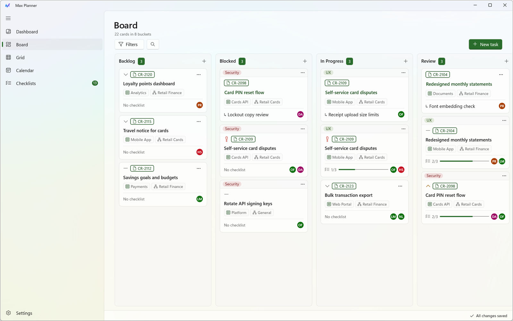
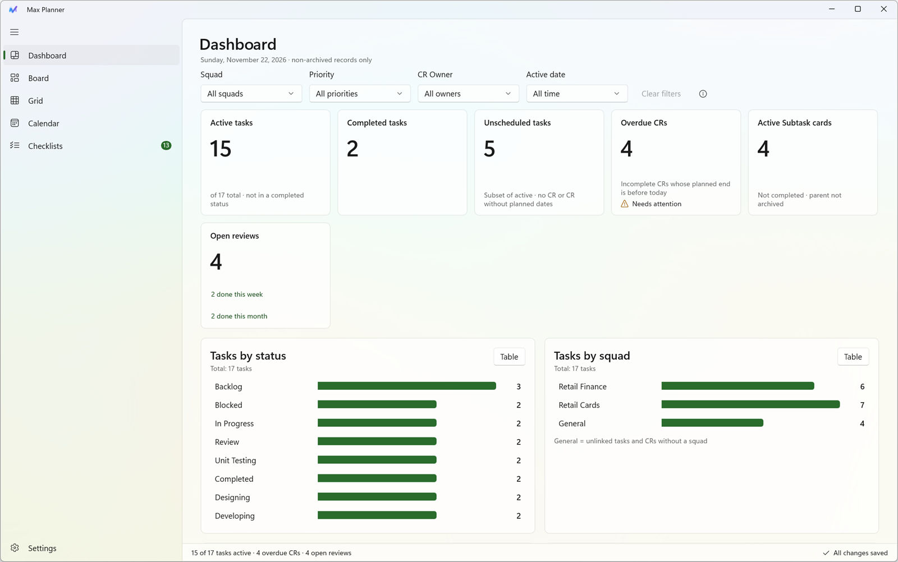
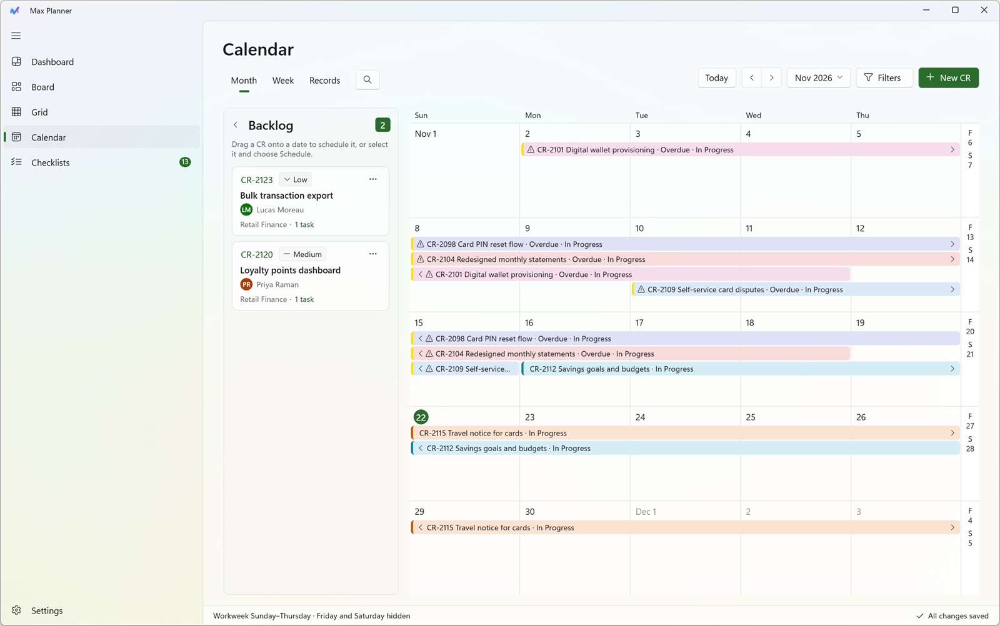
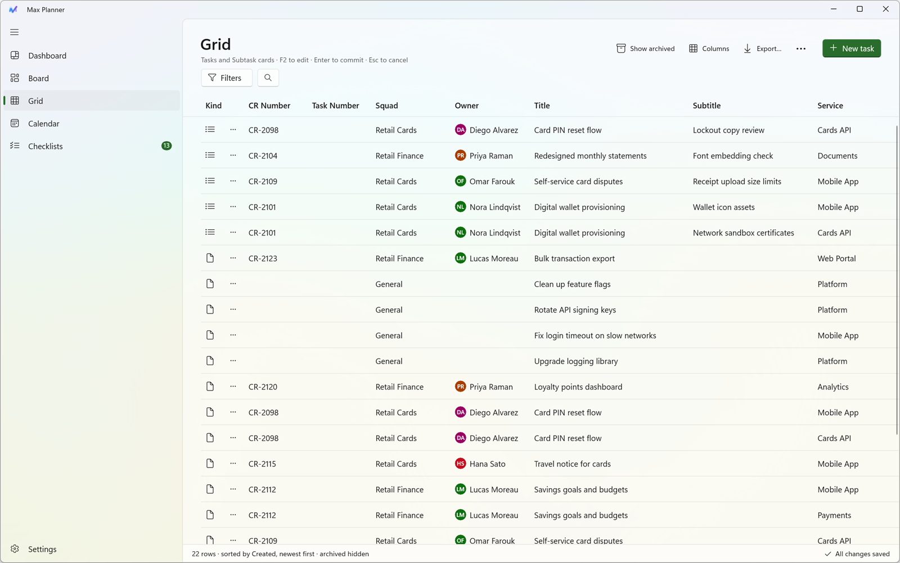
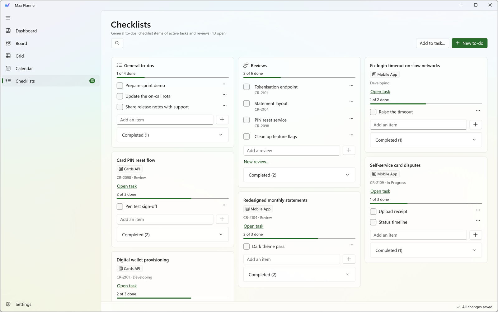

<p align="center">
  
</p>

<h1 align="center">Max Planner</h1>

<p align="center">
  A fast, offline planner for Change Requests, tasks, Subtask cards, checklists and reviews.<br>
  Native Windows app. No installation. Your data stays in one folder.
</p>

<p align="center">
  
  
  
  
</p>

<p align="center">
  <picture>
    <source media="(prefers-color-scheme: dark)" srcset="docs/screenshots/board-dark.png">
    
  </picture>
</p>

---

## Contents

- [Features](#features)
- [Screenshots](#screenshots)
- [Requirements](#requirements)
- [Getting started](#getting-started)
- [Your data](#your-data)
- [Privacy](#privacy)
- [Documentation](#documentation)
- [Building from source](#building-from-source)
- [Project structure](#project-structure)
- [Technology](#technology)
- [Contributing](#contributing)
- [License](#license)

## Features

**Plan the work**
- **Change Requests (CRs)** with owner, squad, status, priority, planned dates, solution design link and description.
- **Tasks** with service, people, tags, notes, actual dates and checklist items. A task links to one CR permanently and shows the CR's values everywhere.
- **Subtask cards** for light-weight pieces of a task, each with its own status and dates.
- **Checklists** and general to-dos, with one-step *Pop out to card*.
- **Reviews** for tracking work you review for others.
- Custom fields for tasks and CRs, and a configurable workflow (statuses, priorities, squads, people, tags, defaults).

**See it your way**
- **Dashboard**: summary cards and charts with drill-down into the matching records.
- **Board**: one bucket per status, with drag and drop and full keyboard moves.
- **Grid**: a spreadsheet view with in-place editing, sorting, column layout and export.
- **Calendar**: month and week views of scheduled CRs, a backlog to schedule from, and a sortable records table.
- Search and filters on every page, remembered between sessions.

**Keep it safe**
- Every change is saved immediately to a local SQLite database, and every page updates at once.
- A daily automatic backup (the last 7 are kept), manual backups, and a safety backup before every restore, import and upgrade.
- **Export** to JSON, Excel (.xlsx), CSV, or a ZIP of CSV tables. **Import** Max Planner files or external CSV, Excel, JSON and Markdown, with a mapping step and a preview. An import applies completely or not at all.

**Fit in**
- Optional **Azure DevOps** integration: create a pull request from a task, CR or Subtask card (off by default).
- Light, dark and High Contrast themes, Mica backdrop, and layouts that work down to a narrow Snap window.
- A keyboard route and an accessible name for every command.

## Screenshots

The screenshots use a fictional demo dataset.

**Dashboard**: summary cards, overdue CRs, reviews, and tasks by status and squad.

<picture>
  <source media="(prefers-color-scheme: dark)" srcset="docs/screenshots/dashboard-dark.png">
  
</picture>

**Calendar**: CRs on a Sunday–Thursday month view, with unscheduled CRs in the backlog.



**Grid**: every task and Subtask card in an editable, sortable table.



**Checklists**: General to-dos, reviews, and the checklist of each active task.



## Requirements

| | |
|---|---|
| Operating system | Windows 11 x64. Tested on 24H2 (build 26100) and 25H2 (build 26200); 22H2 (22621) and later are expected to work. |
| Installed software | None. The .NET runtime and Windows App SDK are included. |
| Rights | A standard user account. No administrator rights. |
| Storage | A folder you can write to, such as Documents or a USB drive. |

## Getting started

1. Download `MaxPlanner-<version>-win-x64.zip` from the [Releases](https://github.com/ETBMina/MaxPlanner/releases) page.
2. Optionally check the download against `MaxPlanner-<version>-win-x64.zip.sha256`:
   ```powershell
   Get-FileHash .\MaxPlanner-<version>-win-x64.zip -Algorithm SHA256
   ```
3. If Windows marks the file as downloaded, right-click the ZIP, select **Properties**, and select **Unblock**. The binaries are not code-signed, so SmartScreen may warn on first start.
4. Extract the ZIP to a folder you can write to. Keep the `MaxPlanner` folder together.
5. Run `MaxPlanner.exe`.

Starting the app a second time from the same folder brings the open window to the front.

**Updating:** close the app, copy the `data` folder as a precaution, and extract the new ZIP over the old folder. The ZIP never contains a `data` folder, so it cannot overwrite your records. If the new version needs to upgrade your data, it makes a safety backup first.

**Removing:** close the app and delete the folder. Max Planner writes nothing to the registry, AppData or package store. If you set an Azure DevOps token, remove it first in **Settings › Integrations**.

## Your data

Everything lives in a `data` folder created beside `MaxPlanner.exe` on first start:

```text
MaxPlanner/
  MaxPlanner.exe
  data/
    data.db               your records (SQLite)
    configuration.json    settings and preferences
    backups/              daily, manual and safety backups
    logs/                 diagnostic logs (no record titles or notes)
```

To move or copy Max Planner, close it and move the whole folder; your records, links and preferences go with it. Do not run it live from a network share or a folder a cloud service synchronizes while the app is open.

The one item stored outside the folder is the optional Azure DevOps personal access token, which is kept in Windows Credential Manager for the current Windows user.

## Privacy

Max Planner has no account, activation, telemetry, update check or online license check. It connects to the network only when you use the optional Azure DevOps integration, and only to the server you configure.

## Documentation

| Document | For |
|---|---|
| [User guide](docs/user-guide.md) | Concepts, pages, editors, filters, import and export, keyboard shortcuts |
| [Deployment guide](docs/deployment-guide.md) | The portable artifact, upgrades, exit codes, and release gates |
| [Development prerequisites](docs/dev-prerequisites.md) | Toolchain, scripts and developer commands |
| [Architecture decisions](docs/adr/) | Accepted design decisions (ADRs) |
| [Design reference](design.md) | UI and interaction design |
| [Business requirements](Business%20Requirements.md) | The original product specification |

## Building from source

### Prerequisites

- Windows 11 x64
- [.NET SDK 10.0.401](https://dotnet.microsoft.com/download/dotnet/10.0) (pinned in `global.json`)
- PowerShell 7
- WinApp CLI 0.7.1 or later, to run the app during development (`winget install Microsoft.WinAppCli`)
- Visual Studio is optional; open `MaxPlanner.slnx`

Package versions are pinned centrally in `Directory.Packages.props`, and lock files are committed.

### Build, test and run

```powershell
./scripts/build.ps1                      # restore and build (Debug, x64); warnings are errors
./scripts/test.ps1                       # all tests except the Desktop smoke tests
./scripts/test.ps1 -IncludeSmoke         # also the smoke tests, which launch the app
winapp run src/MaxPlanner.Desktop/MaxPlanner.Desktop.csproj -p Platform=x64 --detach --json
```

### Publish the portable ZIP

```powershell
./scripts/publish-portable.ps1 -Version 1.0.0
./scripts/verify-portable.ps1 -Zip artifacts/MaxPlanner-1.0.0-win-x64.zip
```

The ZIP and its checksum are written to `artifacts/`. The release gates and clean-machine checks are described in the [deployment guide](docs/deployment-guide.md).

## Project structure

```text
src/
  MaxPlanner.Domain           entities and business rules; no dependencies
  MaxPlanner.Application      use cases, ports and read models
  MaxPlanner.Infrastructure   SQLite storage, import and export, backups, Azure DevOps client
  MaxPlanner.Presentation     WinUI 3 views, view models and the shared projection store
  MaxPlanner.Desktop          app entry point and composition
tests/                        one test project per layer, plus architecture, smoke and benchmark tests
scripts/                      build, test, publish and verification scripts
tools/                        fixture generator and third-party notices generator
docs/                         user and deployment guides, ADRs, brand assets
```

The layering rules are enforced by `MaxPlanner.Architecture.Tests`: the UI never touches the database, and Domain depends on nothing.

## Technology

- C# on .NET 10, WinUI 3 (Windows App SDK 2.x), MVVM with CommunityToolkit.Mvvm
- SQLite through Microsoft.Data.Sqlite, with one ordered writer
- DynamicData and System.Reactive for the shared projection store that keeps every page current
- Unpackaged, self-contained x64 deployment as a portable ZIP: no MSIX, installer or runtime install
- xUnit v3 on Microsoft Testing Platform, ArchUnitNET, and BenchmarkDotNet

The full list of bundled components and their licenses is in [THIRD-PARTY-NOTICES.md](THIRD-PARTY-NOTICES.md).

## Contributing

Max Planner does not accept code contributions; pull requests are closed without review. Bug reports and suggestions are welcome as [issues](https://github.com/ETBMina/MaxPlanner/issues). See [CONTRIBUTING.md](CONTRIBUTING.md).

## License

Copyright © 2026 Mina Talaat Hakim.

Max Planner is licensed under the [PolyForm Internal Use License 1.0.0](LICENSE). You may use and modify it for the internal business operations of you and your company. You may not distribute it. See [LICENSE](LICENSE) for the full terms and [ADR 0032](docs/adr/0032-license-polyform-internal-use.md) for the reasoning.

Third-party components are licensed under their own terms; see [THIRD-PARTY-NOTICES.md](THIRD-PARTY-NOTICES.md).
